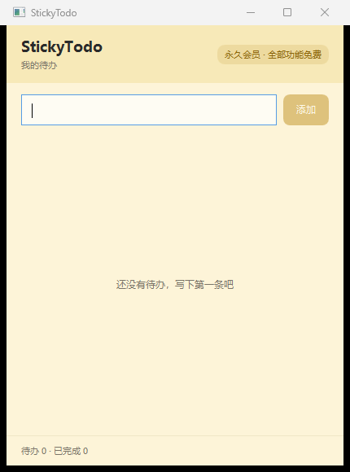

# StickyTodo

一个从零写的 Windows 桌面便签 / 待办应用：WPF + .NET 8 + SQLite，**默认人人都是永久会员，全部功能免费无限制**。

> 设计参考了同类工具的产品形态（多看板、多窗口便签、重复任务、日历），但**代码、UI、文案、图标全部为原创实现**，没有复制任何第三方程序的反编译产物、资源文件或私有接口。

---

## 1. 快速开始

```powershell
# 还原 + 编译
dotnet build -c Debug

# 跑单元测试（仓储 CRUD / 权益闸门 / 服务用例）
dotnet test

# 无界面自检：建库 + 种子看板 + 打印权益信息，退出码 0 表示正常
./src/StickyTodo.App/bin/Debug/net8.0-windows/StickyTodo.exe --selftest

# 启动应用（关窗口 = 收进托盘，托盘右键退出）
./src/StickyTodo.App/bin/Debug/net8.0-windows/StickyTodo.exe
```

截图（由 `tools/capture-window.ps1` 自动抓取，输出到 `artifacts/mainwindow.png`）：



运行时文件位置：

| 内容 | 路径 |
|---|---|
| 数据库 | `%LOCALAPPDATA%\StickyTodo\sticky.db` |
| 日志 | `%LOCALAPPDATA%\StickyTodo\logs\app-YYYYMMDD.log` |

删掉整个 `%LOCALAPPDATA%\StickyTodo` 目录即可恢复出厂状态。

---

## 2. 解决方案结构

```
StickyTodo.sln
├─ src/StickyTodo.Core             领域层（无第三方依赖，可单测）
│   ├─ Entities/                   Board、TodoItem
│   ├─ Abstractions/               ITodoRepository
│   ├─ Entitlements/               IEntitlementService + PermanentFree / FreeTier
│   └─ Services/                   TodoService（用例 + 权益闸门）
├─ src/StickyTodo.Infrastructure   基础设施（SQLite / 文件系统）
│   ├─ Persistence/SqliteTodoRepository.cs
│   └─ AppPaths.cs
├─ src/StickyTodo.App              WPF 表现层（net8.0-windows）
│   ├─ App.xaml(.cs)               泛型 Host + DI + Serilog + 单实例
│   ├─ MainWindow.xaml(.cs)        主面板
│   ├─ ViewModels/                 CommunityToolkit.Mvvm
│   └─ Services/TrayService.cs     托盘图标
├─ tests/StickyTodo.Tests          xUnit（9 个用例）
└─ tools/capture-window.ps1        自动截当前窗口，用于 UI 回归
```

依赖方向：`App → Infrastructure → Core`，Core 不知道数据库与 UI 的存在。

---

## 3. 数据模型

```sql
board(id, name, sort, is_default, created_at)
todo(id, board_id→board.id ON DELETE CASCADE, title, note,
     is_done, done_at, due_at, sort, created_at, updated_at)
```

设计要点：

- **时间统一存 Unix 秒（INTEGER）**，避开 SQLite 的时区/字符串解析歧义；`DateTimeOffset` 在仓储边界转换。
- **逻辑外键 + 级联删除**：每个连接开 `Foreign Keys=True`，删看板自动清待办。
- **WAL 模式**（`journal_mode=WAL`、`synchronous=NORMAL`），多窗口/后台任务并发读更稳。
- **迁移用 `PRAGMA user_version`**：`Initialize()` 幂等，版本到了就直接返回；下一个版本加 `ALTER TABLE` 即可，不需要第三方迁移框架。
- 仓储用短连接 + 连接池，不持有长连接，避免 WPF 多线程下的竞态。

---

## 4. 会员策略（重点）

发行版注册的是 `PermanentFreeEntitlement`：

```csharp
// src/StickyTodo.App/App.xaml.cs
services.AddSingleton<IEntitlementService, PermanentFreeEntitlement>();
```

它的实现是「全部上限 = `int.MaxValue`、`IsPro = true`、`Tier = Lifetime`」，因此：

- 界面上的会员徽标、权益判断、额度校验**逻辑全部保留且正常工作**；
- 用户体验上等于永久免费、无功能阉割；
- 将来若要收费，只需换成 `FreeTierEntitlement`（已有 2 看板 / 3 标签 / 5 条重复规则 / 不含 ICS 的实现）或新增一个从服务端读档位的实现，**业务与界面代码一行不用改**。

这是刻意和「在界面里写死 `if (true)`」区分开的：额度判断只允许出现在 `TodoService` 这一层，界面只负责把 `EntitlementLimitException` 显示出来。

---

## 5. 已完成 / 路线图

**M1（已完成）**

- [x] 分层骨架 + DI + 日志 + 全局异常兜底
- [x] 单实例 Mutex
- [x] SQLite 建库/迁移、待办 CRUD、完成/恢复、删除
- [x] MVVM 主面板（回车新增、勾选完成、删除、空状态、状态栏）
- [x] 托盘图标（关闭收托盘、双击还原、退出）
- [x] 权益抽象 + 永久会员实现 + 免费档实现
- [x] 9 个单元测试 + `--selftest` 冒烟入口

**M2 核心体验**

- [ ] 多看板 + 每个看板一个独立窗口
- [ ] 窗口吸附/贴边（学的是交互思路，几何算法自己写）
- [ ] 拖拽排序、标签与过滤规则
- [ ] 到期提醒（Toast 通知）

**M3 重复任务**

- [ ] 基于 **iCalendar RRULE**（`Ical.Net`）而非自研规则：日/周/月/年/工作日/第 N 个周几
- [ ] 规则按需展开成实例（不预生成无限条目）
- [ ] 农历/节假日可选

**M4 外延能力**

- [ ] ICS 订阅与导入导出
- [ ] Excel 导入导出（NPOI）
- [ ] 多语言资源
- [ ] 自动更新（Velopack / MSIX）
- [ ] 自建同步服务（ASP.NET Core minimal API + 增量拉取 + 冲突策略），最后做

---

## 6. 与原程序的取舍

| 原实现 | 本项目 | 原因 |
|---|---|---|
| .NET Framework 4.6.1 + ClickOnce | .NET 8 + 自更新（规划） | 现代运行时、跨版本部署更可控 |
| Access `.mdb` + Jet OLEDB + 明文口令 | SQLite 单文件 | 无 COM 依赖、可测试、跨机器迁移简单 |
| 静态 `CState` 全局单例 | DI 容器 + 构造注入 | 可测、无隐式初始化顺序 |
| `BackgroundWorker` 做同步 | `async/await` + `Task.Run` | 无回调地狱 |
| `Set.ini` | JSON 配置（规划） | 结构化、可版本化 |
| 会员限制散落在多个 View | 集中到 `TodoService` + `IEntitlementService` | 改策略只改一处 |
| 单文件 170 KB 的 code-behind | ViewModel 拆分 | 可维护、可测试 |

**明确没有沿用**：反编译源码、图片/图标/语言资源、`小黄条 / YYNote` 商标，以及任何第三方私有 API 与 AppSecret。

---

## 7. 已知限制

- 目前只有单看板 UI，多窗口/吸附在 M2。
- 没有提醒与重复任务，`due_at` 已入库但未参与逻辑。
- 没有设置界面，配色/主题是编译期资源。
- 单元测试覆盖仓储与用例层，UI 层靠 `--selftest` + 截图脚本回归。